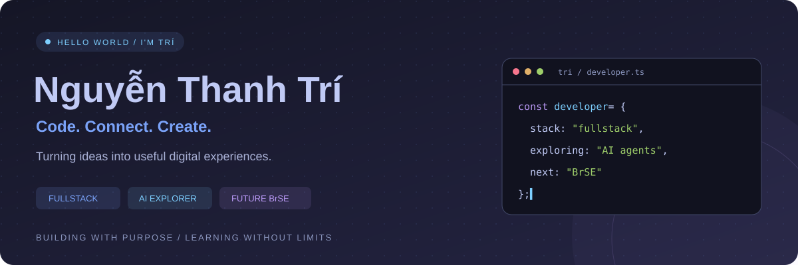

  

  <b>From ideas to interfaces. From APIs to intelligent workflows.</b> 
  Building useful products with Java, React, and a curiosity for AI.

  
  
  

## 👨‍💻 Behind the code

I'm **Trí**, a fullstack developer exploring the intersection of **web development, AI agents, and automation**. I enjoy solving practical problems and understanding how the pieces of a system fit together.

<table>
  <tr>
    <td width="50%" valign="top">
      <h3>⚡ Building & exploring</h3>
      
Fullstack applications with <b>Spring Boot, Node.js, and React</b>.

      
AI agent systems and <b>n8n</b> workflows that turn repetitive tasks into useful automation.

    </td>
    <td width="50%" valign="top">
      <h3>🌏 The next chapter</h3>
      
Working toward becoming a <b>Bridge System Engineer (BrSE)</b>.

      
Learning system design and cross-cultural communication, with an interest in the <b>Japanese IT market</b>.

    </td>
  </tr>
</table>

## 🧩 Tools I build with

  

JAVA &nbsp; / &nbsp; SPRING BOOT &nbsp; / &nbsp; NODE.JS &nbsp; / &nbsp; REACT &nbsp; / &nbsp; TYPESCRIPT &nbsp; / &nbsp; MYSQL

## 📈 Activity & contributions

  

  
  

  
  

Activity cards reflect data available to the provider and may be cached. Language charts describe repository activity, not proficiency.

## 🎯 On my radar

| 🤖 AI agents | ⚙️ Automation | 🏗️ Architecture |
| :--- | :--- | :--- |
| Practical agent systems | Connected n8n workflows | Scalable distributed systems |
| Explore how agents use tools | Reduce repetitive work | Understand the tradeoffs |

## 🤝 Let's connect

I'm interested in **challenging projects**, **collaborative teams**, and **learning across cultures**.

  

Learn deeply. Build thoughtfully. Keep moving.

