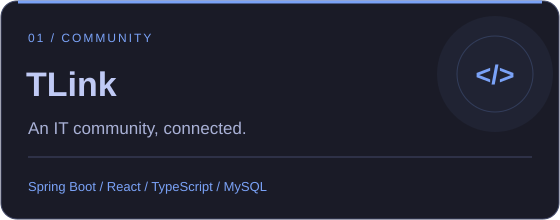
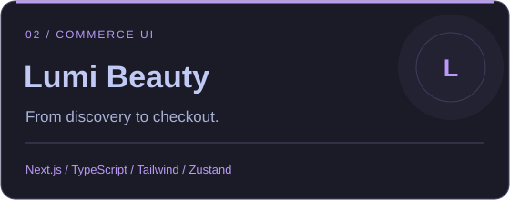
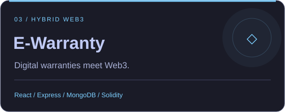
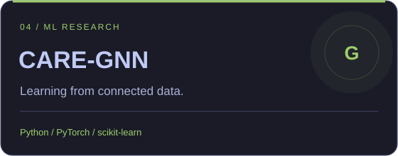

  

  <b>From ideas to interfaces. From APIs to intelligent workflows.</b> 
  Web applications · Mobile experiments · Web3 · Graph machine learning

  
  
  

## 👨‍💻 Behind the code

I'm **Trí**, a fullstack developer exploring the intersection of **web development, AI agents, and automation**. My repositories span community platforms, commerce interfaces, blockchain warranties, and graph-based machine learning experiments.

<table>
  <tr>
    <td width="50%" valign="top">
      <h3>⚡ Building & exploring</h3>
      
Fullstack applications with <b>Spring Boot, Express, React, and Next.js</b>.

      
AI agent systems and <b>n8n</b> workflows that turn repetitive tasks into useful automation.

    </td>
    <td width="50%" valign="top">
      <h3>🌏 The next chapter</h3>
      
Working toward becoming a <b>Bridge System Engineer (BrSE)</b>.

      
Learning system design and cross-cultural communication, with an interest in the <b>Japanese IT market</b>.

    </td>
  </tr>
</table>

## 🚀 Selected projects

<table>
  <tr>
    <td width="50%" valign="top">
      
      
Community discussions, threaded replies, Google sign-in, and a chatbot interface for guided post actions.

      <a href="https://github.com/ThanhTris/TLink">Explore TLink ↗</a>
    </td>
    <td width="50%" valign="top">
      
      
Beauty storefront and admin interfaces, with product discovery, cart, checkout, and shared frontend modules.

      <a href="https://github.com/ThanhTris/Lumi-Beauty-FE">Explore Lumi Beauty ↗</a>
    </td>
  </tr>
  <tr>
    <td width="50%" valign="top">
      
      
Electronic warranties using ERC-721, MetaMask, Ethereum Sepolia, and IPFS alongside a conventional API.

      <a href="https://github.com/ThanhTris/IE213">Explore E-Warranty ↗</a>
    </td>
    <td width="50%" valign="top">
      
      
Spam review detection on YelpChi: an implementation of the published CARE-GNN model, with a GraphSAGE baseline and evaluation plots.

      <a href="https://github.com/ThanhTris/IS353">Explore CARE-GNN ↗</a>
    </td>
  </tr>
</table>

**🛠️ In progress — [Gì Cũng Được](https://github.com/ThanhTris/IE307)** 
A group food-choice app being developed with **React Native, Expo, TypeScript, and Supabase/PostgreSQL local tooling**. Current work includes the mobile foundation, data preparation, and backend contracts.

<b>More projects & coursework</b>

- [Library Web · IE103](https://github.com/ThanhTris/IE103) — React interfaces with a Java / Spring Boot / MySQL backend.
- [Movie Reviews labs](https://github.com/ThanhTris/23521645-NguyenThanhTri-IE213.Q21) — React, Express, and MongoDB coursework.
- [Sun Asterisk training](https://github.com/ThanhTris/-Sun-Asterisk---TI-Training) — UI reconstruction with HTML, CSS, Sass, and Tailwind; a React / TypeScript search frontend.

## 🧩 Technology across my projects

<b>WEB & INTERFACES</b>

  

<b>BACKEND & DATA</b>

  

<b>ML & WEB3</b>

  

| Area | Also used in these repositories |
| :--- | :--- |
| **Frontend state** | Zustand · Redux Toolkit · SWR |
| **Backend foundations** | Spring Security · Spring Data JPA · JWT · Mongoose |
| **ML experiments** | NumPy · SciPy · Matplotlib · Seaborn |
| **Web3 integration** | Ethers.js · Hardhat · OpenZeppelin · IPFS / Pinata |
| **Current mobile work** | React Native · Expo Router · Supabase / PostgreSQL |

This stack comes from the source and dependency manifests of my projects. AI agents and n8n remain areas I'm exploring.

## 📈 Activity & contributions

  

  
  

  
  

Activity cards reflect data available to the provider and may be cached. Language charts describe repository activity, not proficiency.

## 🎯 On my radar

| 🤖 AI agents | ⚙️ Automation | 🏗️ Architecture |
| :--- | :--- | :--- |
| Practical agent systems | Connected n8n workflows | Scalable distributed systems |
| Explore how agents use tools | Reduce repetitive work | Understand the tradeoffs |

## 🤝 Let's connect

I'm interested in **challenging projects**, **collaborative teams**, and **learning across cultures**.

  

Learn deeply. Build thoughtfully. Keep moving.

